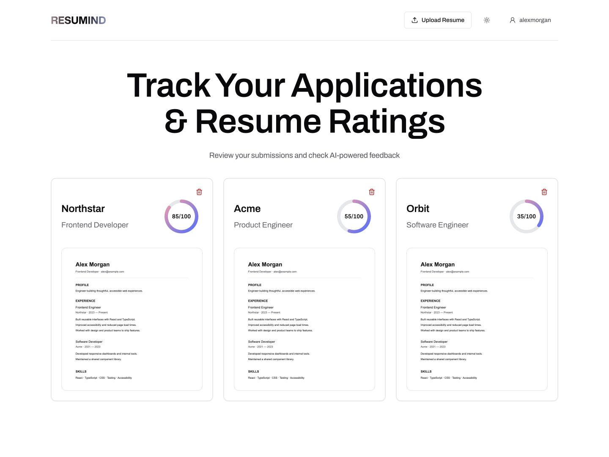

<h1 align="center">Resumind</h1>

<p align="center">Resume feedback tailored to the role.</p>

<p align="center">
  <a href="https://resumindd.puter.site">Live application</a> ·
  <a href="https://github.com/belkysupreme22/Resumind/releases">Releases</a> ·
  <a href="https://github.com/belkysupreme22/Resumind/actions">CI/CD</a>
</p>

<picture>
  <source media="(prefers-color-scheme: dark)" srcset="public/images/product/dashboard-dark.jpg">
  <source media="(prefers-color-scheme: light)" srcset="public/images/product/dashboard-light.jpg">
  
</picture>

<p align="center"><sub>Dashboard preview with sample data.</sub></p>

## Features

- Guided PDF upload with required job context and a review step before analysis.
- Overall and ATS scores, plus feedback on tone, content, structure, and skills.
- Saved reviews, resume previews, and file management in a signed-in dashboard.
- Interactive sample review, responsive navigation, and light, dark, or system themes.
- Validation, loading and empty states, and retries that preserve completed analysis work.

## Usage

1. Sign in with Puter.
2. Upload a PDF resume, up to 20 MB.
3. Enter the job title and description; the company name is optional.
4. Review your details, start analysis, and open the saved feedback.

Scores are AI-generated estimates. Review the suggestions before changing your resume.

## Local development

Use Node.js 24, as specified in `.node-version`.

```bash
npm ci
npm run dev
```

Open the local URL printed by Vite, usually `http://localhost:5173`.
Puter sign-in and cloud services require an internet connection.

## Validation and build

```bash
npm test
npm run typecheck
npm run build
npm run check:build
```

The production output is `build/client`. This is a static React Router SPA;
direct workspace links require the included `.puter_site_config` routing fallback.

## Architecture

Puter provides authentication, file storage, AI analysis, and key-value storage.
The browser uses the Puter SDK through a Zustand store; no custom backend is required.
PDF.js generates resume previews locally. Tailwind CSS and shared CSS tokens
define the interface, with Lucide icons and Archivo typography.

| Location | Purpose |
| --- | --- |
| `app/routes/` | Landing, sign-in, dashboard, upload, and review pages |
| `app/components/` | Shared navigation, feedback, theme, and state components |
| `app/lib/puter.ts` | Puter SDK integration and application store |
| `app/lib/reviews.ts` | Analysis stages, feedback validation, and retry handling |
| `app/app.css`, `app/styles/` | Typography, themes, and component styles |
| `constants/index.ts` | Analysis prompts and expected feedback format |
| `scripts/`, `tests/` | Deployment tooling and automated checks |

## Deployment and releases

GitHub Actions checks pull requests. Successful deployments from `main` upload
the tested build to Puter, verify the live routes, and publish a GitHub Release
with the website URL, commit, deployment folder, and build archive.

Configure these under **Settings → Secrets and variables → Actions**:

| Type | Name | Value |
| --- | --- | --- |
| Secret | `PUTER_TOKEN` | Account API token with access to the hosted website |
| Variable | `PUTER_SUBDOMAIN` | `resumindd` for the current deployment |

Release publishing uses the workflow's `GITHUB_TOKEN`; no additional secret is
required. Set the Puter app's **Index URL** to `https://resumindd.puter.site`.

See [deployment documentation](docs/deployment.md) for setup, permissions,
release behavior, and rollback instructions.
